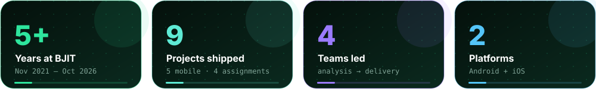
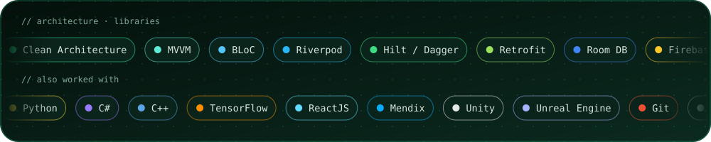

&nbsp;
&nbsp;

  

 

I'm a **Senior Software Engineer** with **5 years at BJIT**, mainly building **mobile apps for Android and iOS with Flutter and Kotlin Multiplatform**, plus native Android with **Kotlin and Jetpack Compose**. My work covers real-time communication, hardware and device integration, push messaging, health tech, utility apps and AI-assisted features. I also build **agentic AI automation**: LLM assistants that call real APIs and local actions, with allowlists and human approval built in. I lead teams from analysis and design through testing and debugging.

Most of my career has been in mobile. When my company needed it, I also took on assignments in low-code (Mendix), web (ReactJS) and VR (Unity and Unreal), which broadened my range as an engineer.

 

| | |
|---|---|
| 🔎 **Status** | Open to mobile roles across Android and iOS: Flutter, KMP, Kotlin, and team-lead positions |
| 📱 **Core focus** | Flutter and Dart, Kotlin Multiplatform, native Android (Kotlin, Jetpack Compose) |
| 🤖 **Also building** | Agentic AI automation with n8n, Gemini and Ollama: [Jarvis](https://github.com/FahimFoysal97/Simple_AI_Assistant) and the [Job Application Assistant](https://github.com/FahimFoysal97/Job-Application-Assistant) |
| 🏗 **I care about** | Clean Architecture, MVVM, BLoC, Riverpod |
| 🌐 **Portfolio** | [fahimfoysalportfolio.vercel.app](https://fahimfoysalportfolio.vercel.app/) |
| 📫 **Reach me** | fahimfoysal97@gmail.com · [LinkedIn](https://www.linkedin.com/in/mdfahimfoysal/) |

 

**AI and automation:** LLM tool calling and agents · n8n · Gemini API · Ollama · Whisper (faster-whisper) · FastAPI · Telegram Bot API

 

### Senior Software Engineer · BJIT Limited, Dhaka
*Nov 2021 – Oct 2026*

`📱 mobile project (my core work)` &nbsp; `🔄 assignment given by the company outside mobile` &nbsp; `👑 I led the team`

| | Period | Project | What I did | Stack |
|:-:|---|---|---|---|
| 🔄 | Jul – Oct 2026 | **Mendix proof of concept** | Learned Mendix and developed a confidential project for the client. | `Mendix` |
| 🔄 | Mar – Jun 2026 | **Fully autonomous app development platform** | Learned ReactJS and built a code generation module, one part of a fully autonomous app development platform, applying LLM-based generation. | `ReactJS` |
| 📱 | Mar 2025 – Feb 2026 | **AI Traveler Diary** (Jasmy Labo) | Tracks locations during a trip and collects photos to create a travel diary, written with the help of AI. Covered analysis, design, development, testing and debugging. | `Flutter` `Dart` `Java` `XML` `Swift` |
| 📱👑 | Jun 2024 – Feb 2025 | **MR-APP for CWASA** | Led the team on an app for water meter inspectors to post readings, print bills and report meter problems. | `Kotlin` `MVVM` `Retrofit` `Hilt-Dagger` `Jetpack Compose` `Firebase Messaging` `POS thermal print` |
| 🔄👑 | May 2024 | **Desa_VR** | Led the team building a menu for a virtual museum. A one month project. | `Unreal Engine` |
| 🔄👑 | Sep 2023 – Apr 2024 | **Training_4IR** | Learned VR development through small projects, and led the team. | `Unity` `C#` `Unreal Engine` |
| 📱👑 | Jul – Sep 2022 and May – Aug 2023 | **Sharjah University Type 2 Diabetes PoC** | Led the team on a health and fitness app for research on the daily activity of children who may get type 2 diabetes. | `Kotlin` `MVVM` `Retrofit` `Hilt-Dagger` `Jetpack Compose` `Firebase Messaging` |
| 📱 | Oct 2022 – Apr 2023 | **JSDE Wallet and Door Lock** (Jasmy Labo) | Secure data exchange over WebRTC, plus a remote door lock and unlock system. | `Java` `Kotlin` `XML` `Retrofit` `WebRTC` `SQLite` |
| 📱 | Nov 2021 – Jun 2022 | **Pocketalk device** | Software for a voice translation device: the user speaks in one language and the device translates it into their preferred one. | `Java` `Kotlin` `XML` `Retrofit` `SQLite` `translate engines` |

 

| Project | What it does | Tech | Link |
|---|---|---|---|
| 🤖 **Jarvis: Personal AI Assistant** | Nov 2026. Self-hosted assistant controlled by Telegram or a "Hey Jarvis" voice wake word, with spoken replies. An agent uses Gmail, Google Calendar, Google Sheets and PC control as tools, and falls back from Gemini to a local Ollama model. The PC-control server is localhost-only with a fixed action whitelist, no shell access, separate API keys, an owner-only allowlist and a confirm-before-acting rule | n8n, Python, FastAPI, Gemini, Ollama, faster-whisper, openWakeWord, Piper TTS | [View repo](https://github.com/FahimFoysal97/Simple_AI_Assistant) |
| 💼 **Job Application Assistant** | Nov 2026. Telegram-controlled, human-in-the-loop assistant that reads a job posting, extracts structured data, scores fit against my resume, flags scam risks and drafts the application. Two-stage approval: nothing is drafted or emailed without an explicit button press, and duplicate applications are blocked | n8n, Gemini, Ollama, Telegram Bot API, Gmail, Google Sheets, Google Drive | [View repo](https://github.com/FahimFoysal97/Job-Application-Assistant) |
| 💊 **LipiRx** | A hobby project that reads handwritten prescriptions for pharmacies in Bangladesh using Vision AI. Built to explore Kotlin Multiplatform and AI integration. An assistive tool: a pharmacist must verify every result | KMP, Compose Multiplatform, Gemini, Groq, OpenAI, Ollama | [View repo](https://github.com/FahimFoysal97/LipiRx) |
| 🎬 **Movie App** | Nov 2021. Android sample app using modern best practices and a free movie API | Kotlin, MVVM, Hilt, Retrofit | [View repo](https://github.com/FahimFoysal97/MovieApp) |
| 🕵️ **Manipulated Image Detector** | 2019 to 2020. Android app that checks whether an image was manipulated, using a neural network | Java, Python, Neural Network | [View repo](https://github.com/FahimFoysal97/ManipulatedImageDetector) |
| 📋 **Automatic Attendance** | 2019. Takes student attendance automatically over WiFi Direct | Java, XML, WiFi Direct | [View repo](https://github.com/FahimFoysal97/AutomaticAttendance) |
| ⛅ **Weather App** | 2018. Current weather and the next 7 days | Java, XML, Weather API | [View repo](https://github.com/FahimFoysal97/WeatherApp) |

 

 

- 🥇 **4th place**: CoU CSE Fiesta 2015, Inter University Programming Contest
- 💻 **300+ problems solved** on [LeetCode](https://leetcode.com/fahimfoysal97/), [BeeCrowd](https://www.beecrowd.com.br/judge/en/profile/59519) and [HackerRank](https://www.hackerrank.com/profile/Fahim_Foysal)
- ⭐ **Gold badges** in Java and Problem Solving on HackerRank

 

- **BSc (Engg.) in Computer Science & Engineering**: Comilla University, 2015–2020
- **BJIT Academy:** Android Development, Project Management, Japanese Business Culture, Business Finance & Communication, Workplace Etiquette
- **Also:** iOS development training · VR/AR with Unity and Unreal (basic, [Unity Learn profile](https://learn.unity.com/u/64fef836edbc2a0407e3f640)) · Course: Master Machine Learning for Data Science & AI, Beginner to Advanced

 

&nbsp;
&nbsp;

  

